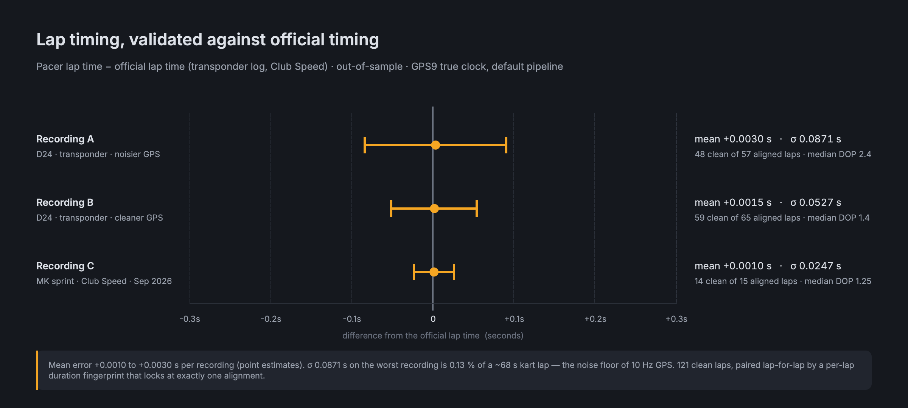

# How accurate is Pacer's lap timing — and how do we know?

**Pacer's lap times are validated out-of-sample against official timing** — the kind of hard
ground truth a race series or a circuit scores a session with: a real transponder log, and a
circuit's own published timing sheet. Over **121 clean laps** across three recordings, the per-lap
spread against that ground truth is **σ 0.025 s, 0.053 s and 0.087 s**, and the mean error is
**+0.0010 to +0.0030 s** per recording — point estimates, not a bound: no interval is computed for
A or B, whose per-lap residuals were not kept, nor given for C (below). On a ~68 s kart lap the
worst recording's σ is about **0.13%**. That is at the noise floor of 10 Hz GPS: the remaining
error is per-fix positional noise on the samples that straddle the finish line, and we can show —
with data — that it is irreducible from the streams a GoPro records.

That is a modest sample, and the honest one: 121 laps actually compared, not the span of their lap
IDs in a 24-hour transponder log.

## The validated numbers

Three GoPro recordings, all at Daytona Milton Keynes on its anticlockwise layout, each timed by
Pacer's **default shipping pipeline** and compared lap-for-lap against official timing. A and B
are **D24**, the Daytona 24-hour race of 23–24 May 2026 — A is `GX0*0060`, B is `GX0*0062` —
checked against the race's transponder log in June 2026; their rows are that measurement, as
recorded. C is a sprint race on **18 September 2026** (`MK_18_09_26`, two chapters), validated in
September 2026 against the circuit's own **Club Speed** timing, whose heat pages are public — on
footage that is on the development machine, by one command a real-footage check re-runs. The
residual is `pacer lap time − official lap time`, measured only on **clean** laps — racing laps
(≤ 72 s on both clocks) with no GPS dropout.

| Recording | Ground truth | GPS quality (median DOP) | Laps aligned | Clean laps measured | Mean error | σ (std) |
|-----------|--------------|--------------------------|--------------|---------------------|------------|---------|
| **A** — D24, higher-noise GPS | transponder log, June 2026 | 2.4 | 57 (transponder laps 302–358) | 48 | **+0.0030 s** | **0.0871 s** |
| **B** — D24, cleaner GPS | transponder log, June 2026 | 1.4 | 65 (transponder laps 856–920) | 59 | **+0.0015 s** | **0.0527 s** |
| **C** — MK sprint, 18 Sep 2026 | Club Speed timing, September 2026 | 1.25 | 15 (sheet laps 2–16) | 14 | **+0.0010 s** | **0.0247 s** |

Those are lap *counts*. An earlier version of this page printed "300+" and "850+" for the same two
rows: those were the transponder log's lap **ID ranges** — it runs continuously for a 24-hour race
across many drivers — not the number of laps compared. The aligned count is the length of the
range (358 − 302 + 1 = 57; 920 − 856 + 1 = 65), and the clean count drops the GPS-dropout and
non-racing laps on top of that. The correction is a factor of ten, in the unflattering direction.

Row C's window is the race itself: its 15 laps are laps 2–16 of one driver's row on the sheet (lap
1 there runs from the start, before the first line crossing a recording can time). The one aligned
lap left out of the clean 14 is the race's opening flying lap, over the 72 s racing cap, and it
reads −0.348 s; the 14 clean residuals all lie between −0.033 s and +0.044 s. With the opening
lap, all 15 aligned laps give σ 0.0903 s. C's mean is a point estimate too: consecutive laps share
a line crossing, so an interval has to model how that crossing's error carries from lap to lap,
and C's 14 clean laps cannot pin it — their lag-1 autocorrelation is +0.03, where independent
crossing noise alone would give −0.5 and purely per-lap noise 0. The recording also holds a
four-lap qualifying run, with a single lap under the cap — too short a fingerprint to lock, so it
is not measured at all. The receiver gated 10.4% of the recording's fixes, every one of them in
its first seven minutes while it acquired; inside the race none were gated, and the median DOP
there was 1.15.

The rows tell the whole story: **recording-level GPS quality sets the floor.** Recording B has
roughly half the spread of A for one reason only — its GPS was cleaner (median DOP 1.4 vs 2.4, ~1%
vs ~4% of fixes gated). Nothing in the algorithm distinguishes the two; the hardware's fix quality
does. C, with the lowest median DOP of the three, has the smallest spread. All three mean errors
are under four milliseconds, as point estimates.

## How it's measured

- **True-clock timing.** On a **GPS9 camera — a Hero 11, Hero 13, MAX2 or MISSION 1**, every GPS
  sample carries its own timestamp on the camera's clock. Pacer times laps on *that* clock, not the
  video clock. A GoPro writes GPS in ~1 s packets, and spreading a packet's fixes evenly places each
  only to about ±0.05 s (28 ms rms against GPS9 on two recordings, 73 ms at worst), so a lap timed
  that way, the difference of two such instants, can read up to ~0.15 s off, with no average bias;
  no GPS5 camera has been timed against official timing. The two clocks' rates differ by only
  ~27 ppm. The GPS lag the gyroscope measures (about 0.46 s, below) is taken out of the video, not
  the clock: no lap time changes with it. A lap time is
  `(finish crossing instant) − (start crossing instant)`, where each instant is interpolated along
  the chord between the two real GPS samples straddling the start/finish line. GPS9 is
  narrower than it sounds: GoPro's metadata spec introduces it with the Hero 11, records it
  *removed* on the Hero 12 ("No GPS receiver in HERO12" — that camera cannot be lap-timed at all),
  and brings it back on the Hero 13, whose metadata the MAX2 and MISSION 1 inherit. Pacer is tested
  on a Hero 13; a spec entry is not a tested file. Hero 5 through Hero 10, the Fusion and the
  original Max emit GPS5 only, which carries no per-sample clock; those recordings fall back to the
  video clock and every duration derived from it is muted and labelled estimated. The detection is
  per recording, off the stream itself (`studio/load.py::_used_gps9_trueclock`), not off a model
  name.
- **The GPS-quality verdict is judged over your laps.** A fix with no 3D lock, or a DOP above 10,
  is rejected and never reaches a lap. The app calls a recording's GPS quality low, keeps it out of
  PBs and focus lists and mutes its times, when 8% or more of the fixes taken while moving, from the
  first start/finish crossing to the last, were rejected. The stationary lead-in, the out-lap and
  the in-lap time no lap, so they are left out: a receiver still acquiring on the grid does not
  downgrade the laps it then timed. A recording with fewer than two crossings is judged over all
  its driving, and so is one with a rejected fix within 14 fixes (1.4 s at 10 Hz) of its first or
  last crossing, twice the 7 fixes through which the 13-fix position smoother can still move that
  crossing (measured: up to +282 ms at 0.4 s, exact from 0.65 s). On a synthetic recording with a
  2D fix for its first 164 s (20% of its moving fixes) all 11 timed laps equal a clean control's to
  the millisecond; the three laps with no fix at their start are lost, and the status bar names the
  driving that was left out.
- **Default pipeline, nothing special.** These numbers come from the shipping configuration —
  GPS9 true-clock, clock rate = 1.0, boxcar smoothing w=13 — not a tuned-for-the-benchmark variant.
  Row C was timed on the built-in Daytona Milton Keynes start/finish line, exactly as a first open
  of the recording times it; its own best-fit clock rate comes out at 0.999983, 17 ppm from 1.
- **Auto-locked to the official timing — and the lock is *unique*.** No lap is hand-matched. The
  app's per-lap *duration* sequence is correlated against every candidate contiguous window of the
  ground truth and the alignment is taken at the maximum. Because that window is *chosen* to
  maximise r, the r value at the winner is not an independent accuracy statistic — the **margin
  over every rival window is**. Against the transponder log the fingerprint matches at **r ≥ 0.99
  at exactly one offset and below 0.29 at every other** (a margin of ≈ +0.70 on recording A), and
  three further signals bound the same window independently — the GPS9 wall clock, elapsed time
  since the green flag, and the long pit/driver-change laps that bracket the stint. A sprint has
  none of those, and its sheet holds every driver of every heat that day, so for row C the
  fingerprint is tried against all of them:

  | Recording | Searched | r at the lock | Best rival's r | Margin | Residual σ, lock vs nearest rival |
  |-----------|----------|---------------|----------------|--------|-----------------------------------|
  | **A** | one transponder log | 0.992 | below 0.29 | **≈ +0.70** | not recorded |
  | **B** | one transponder log | 0.997 | not recorded | not recorded | not recorded |
  | **C** | 122 windows of 99 driver rows, 11 heats | 0.9998 | 0.83 | **+0.17** | 0.025 s vs 1.10 s — **44×** |

  C's margin is small for a reason that is not ambiguity: every driver in one race shares its slow
  opening laps and its yellows, so over 14 laps another driver in the same race reaches r = 0.83 —
  and r is blind to level and scale, so it cannot see that driver missing every lap by seconds. The
  residual σ can: every window but one leaves at least 1.10 s, the lock leaves 0.025 s. The rule
  that calls a sprint lock unique — the best-r window also leaves the smallest residual σ, r ≥ 0.95,
  and every other window's σ is at least 3× the lock's — was committed to the harness before this
  sheet was first locked against it. Take the locked driver's row out of the sheet and the same
  laps lock onto nothing.
- **Reproducible — by one command, on footage on the development machine.** The harness is
  [`studio/dev/_validate_wallclock.py`](../studio/dev/_validate_wallclock.py): given a recording
  and a timing sheet, and no race start, it runs the lock above and reports each stint's residual
  only if it locks. [`studio/dev/clubspeed.py`](../studio/dev/clubspeed.py) turns the circuit's saved
  heat pages into that sheet, and never reads a driver's name off them. Row C is re-measured by the
  `footage.accuracy_mk` check on every `pixi run test-footage`, which fails if any figure above
  moves. The ground truth is never committed — the method is public; the transponder CSV and the
  timing sheets (other drivers' lap times) stay out of the repo. Rows A and B cannot be re-run from
  this repository: they are historical measurements, reported as they were recorded in
  [`studio/docs/`](../studio/docs/gps-accuracy-research.md) at the time.
- **Verify it yourself, no footage needed.** `pixi run verify` times a synthetic two-chapter GoPro
  recording with known truth through the real loader — noise-free, every lap within 0.41 ms at a
  line mid-straight (0.80 ms at the app's own line) — then runs the golden gate. It proves the
  clock, chapter seam and crossing interpolation; the rows above measure the noise floor.
- **Still to come: Sandown Park**, the other circuit the working footage comes from, run clockwise.
  It is timed on Club Speed too, but its heat pages sit behind a sign-in, so its three recordings
  have no row until their sheets are fetched.

## Three findings that show where the limit actually is

The interesting part of this work is not the headline number — it's that we went looking for ways to
push it lower and found, with out-of-sample evidence, that there is nothing left to win on lap
timing. Three results explain why. All three were measured on the two D24 recordings, A and B.

**1. The residual is the raw GPS positional-noise floor.** The remaining error is dominated by
per-fix positional noise on the (present, clean) samples that straddle the finish line. We confirmed
this by ruling everything else out: the error does not correlate with the finish-line chord spacing,
does not track any single GPS-quality predictor across both recordings, and does not shrink under a
principled Kalman/RTS smoother. It is set by the recording's intrinsic 10 Hz fix quality — the same
DOP that separates recording A from B — and is irreducible from the GPMF streams a GoPro exposes.

**2. GPS-dropout laps have their gaps *mid-lap*, not at the finish line.** This is the decisive
finding. The natural assumption is that a lap whose finish crossing falls inside a GPS hole is badly
mis-timed, and that fusing the IMU (dead-reckoning, a Kalman bridge, a spline) across the hole would
fix it. We checked every dropout lap on both recordings: in **every** case the gap sits deep inside
the lap, and **both** start/finish crossings land on clean ~0.1 s chords. Because a lap time depends
only on those two crossing instants — and they sit on real samples far from the hole — **no
gap-bridging method can change these laps' times at all.** The hypothesis was inverted by the data:
the dropouts don't sit where the error would have to be for fusion to help. (What a mid-lap hole
*does* corrupt is the lap *distance* on the map, which Pacer already reconstructs with a gap-aware
speed integral.)

**A missing fix *near* the line is another matter, even a single one.** The load-time position
smoother averages 13 fixes, not 1.3 s, so a fix missing inside its window — one the quality gate
rejected leaves a 0.2 s hole, far under the 0.35 s an interior dropout needs — shifts the averaged
position's instant by up to ~46 ms, and the crossing moves with it; a hole of over a second ending
just before the line leaves the next fixes averaged from one side only. On the synthetic recording
in `tests/test_synth_gopro.py`, rejecting 5 % of its fixes at random moved 13 of its 14 laps by up
to 49 ms, faster as often as slower, and a 1.5 s hole ending 0.5 s before a crossing moved the next
lap by 125 ms. So a lap with a missing fix within the smoother's reach of its start or finish
crossing (7 fixes) wears the GPS-dropout ⚠ and stays out of the bests, and every other lap is timed
to the bit as before. A receiver that drops scattered fixes shows many ⚠ laps, never a false best.

**3. Sub-tick "refine the millisecond at the line" tricks buy nothing at 10 Hz.** Phone lap-timers
that run on 1 Hz GPS use IMU acceleration to interpolate the exact instant the car crossed the line,
because at 1 Hz the chord between fixes is a full second wide. At Pacer's 10 Hz it is a tenth of that,
so the crossing sits at most ~0.05 s (about 1 m at speed) from a real fix, and the constant-velocity
crossing interpolation is already **sub-sample** — a higher-order spline moves the crossing instant
by under a millisecond. The trick that matters at 1 Hz is moot here; we are already past it.

Together these say the same thing three ways: **Pacer's lap timing is at the practical limit for this
data.** We tested GPS+IMU sensor fusion, Kalman/RTS smoothing, Doppler-aided positioning, and
map-matching — out-of-sample, on *both* recordings — and none improved the timing residual on both.
The one method that looked best on recording B was the *worst* on recording A: a textbook overfit,
caught precisely because we refuse to validate on a single recording. The full research write-up,
with every technique evaluated and rejected on evidence, is in
[`studio/docs/gps-accuracy-research.md`](../studio/docs/gps-accuracy-research.md).

**Sector splits are read the same way**, interpolated where the lap crosses each sector line, not
at the nearest fix. On a synthetic recording (row 2 of
[`tests/test_truth_matrix.py`](../tests/test_truth_matrix.py)) the interior split's σ is under 1 ms
noise-free, but up to 0.02 s at recording C's GPS noise and 0.05 s at B's: about a lap's, since
each lap's receiver drift is taken off before its splits are timed (described next). Before that
the same row read 0.11 and 0.24 s, several times a lap's, and refusal §26's chip gate still uses
those figures; that "up to" is the worst of the row's three recordings, not the σ the app uses.
On the 40-day synthetic grid below, at recording C's
noise ([`studio/dev/probes/sector_split_sigma.py`](../studio/dev/probes/sector_split_sigma.py),
13 line placements), what dominated a split was the receiver's slowly drifting position error: a
lap crosses the same line twice and cancels it, a split crosses two lines of different heading and
speed and keeps it, most at a slow line (σ 0.035–0.041 s mid-straight, 0.088 s at the worst sector
of the slowest lines). So each lap's trace is first moved by its own receiver shift onto the
session's consensus line, the correction the corner cells already make, and only then crossed with
the sector lines; a lap's start and finish do not move, so its time and the sum of its splits are
exactly as before. The shift is fitted robustly, with the stretches where a lap leaves its usual
line trimmed out, so a lap that runs wide somewhere keeps its correction; a lap too far off its line
for that, or with too little trace, is timed as measured, and its provenance says so. How much
the correction removes depends on how fast the receiver's drift decorrelates, which no recording
has measured: it takes off the part that is one vector over a lap. The split's σ is read under an
ASSUMPTION, a drift that decorrelates over about half a minute (an OU time constant of 30 s,
`stats.SPLIT_DRIFT_TAU_S`); with drift that changes faster than that the step under-covers: at 10 s
the worst sector reads 0.079 s, a 0.22 s rule
([`studio/dev/probes/sector_dedrift.py`](../studio/dev/probes/sector_dedrift.py)). Under that
assumption one split against another of the same recording carries σ 0.026–0.029 s with lines
mid-straight and 0.040–0.042 s at the slowest lines, and one split's σ is 0.047 s at recording
C's GPS noise, at the worst sector of any placement (0.044 s out of sample, 0.046 s over all 80
days); the house rule gives 0.13 s (2√2σ), the last column below. The app's step is 0.15 s,
rounded up from that for sampling headroom; it covers every ten-day set measured but the noisiest
(0.16 s). At the grid's
own 90 s drift, the favourable case, the σ is 0.038 s and the rule 0.11 s. The step does not mean
a split compare is never wrong: on the synthetic grid the right-click menu still offers a few of
its thousands of compares on a pass truly within 0.03 s, or of the wrong sign. Its other limits:
the measured track's slowest point is 13.5 m/s, and a line at a slower hairpin is not covered; a
lap that runs about 3 m off its line for 40 % of the lap still moves its splits by up to 0.03 s
(within the split's own noise; planted excursions of 3–20 m over 50–400 m, one across a sector
line, moved them by at most 0.031 s); on position noise with no drift at all the fitted shift adds at
most 2 ms; a session too short to fit the shift (fewer than three clean laps) keeps its splits as
measured; and a lap too far off its line for the shift to be fitted is timed as measured inside a
de-drifted session, still counted in the SPLITS grid and Quickest passes, with its cells and a
quickest row it leads saying so. No official timing has checked a split. (The truth matrix names its noise levels by its own three-seed calibration, which reads
C's per-lap σ as noise 2.1 and B's as 4.4; the 40-day grid below reproduces C's at noise 1.9 and
B's at 4.0. Same recordings, two calibrations.)

**What the 0.07 s step covers.** The app reads two of its timings as level when they are closer
than one step, 0.07 s: twice the noise of a difference of two lap times (2√2σ) at recording C's
per-lap σ — the cleanest recording measured, and the GPS9 camera the app is built around. Every
other kind of difference is measured at the synthetic GPS noise whose per-lap σ matches C's. On 40
synthetic race days per noise of one driver with nothing changed
([`studio/dev/probes/focus_cross_session.py`](../studio/dev/probes/focus_cross_session.py) and
[`studio/dev/probes/reference_lap_corner.py`](../studio/dev/probes/reference_lap_corner.py)), the
same rule, 2√2σ, gives each recording's noise these steps. The lap column uses each recording's
published per-lap σ (the table at the top); the corner columns, which no official timing has
checked, use the σ measured on the synthetic grid at the matching noise:

| Published recording (per-lap σ) | Synthetic GPS noise (per-lap σ) | Lap | Corner pass | Corner typical, two days | Corner, against another recording's lap | Sector split |
|---|---|---|---|---|---|---|
| C (0.0247 s) | 1.9 (0.0253 s) | 0.07 s | 0.06 s | 0.05 s | 0.06 s | 0.13 s |
| B (0.0527 s) | 4.0 (0.0532 s) | 0.15 s | 0.12 s | 0.10 s | 0.12 s | 0.28 s |
| A (0.0871 s) | 6.5 (0.0863 s) | 0.25 s | 0.20 s | 0.16 s | 0.21 s | 0.46 s |

**The app uses C's row**, so every lap and corner difference is level under 0.07 s, the widest of
those cells, and two sector splits under 0.15 s: their own cell, the worst sector of the worst
line placement measured on de-drifted splits under the 30 s drift assumption, rounded up for
sampling headroom (with lines mid-straight the split column would read 0.10 / 0.20 / 0.33 s; at
a 90 s drift 0.11 / 0.23 / 0.37 s). A noisier recording can differ by more than that from the GPS alone, up
to B's and A's rows, and the app says so where it reads "level". A corner pass is one pass against
another of the same recording (the Corners table's Δbest, Quickest passes); the corner typical is
the focus list's two days; the next column is the Corners table's Δref and the export's corner
cards with a reference recording loaded; the sector split is Quickest passes' sector rows and a
sector's "Compare with my typical pass". A corner pass carries about 0.8 × a lap's σ at every
noise, so it never needs a wider step than a lap.

**A corner's typical time on two different days** is what the focus list compares, and each
recording brings its own bias that more laps of it do not remove. On 40 synthetic race days of one
driver with nothing changed, at GPS noise 1.9, whose per-lap σ is 0.025 s, recording C's, one
session's corner typical carries a bias of σ 0.0178 s against truth (0.0142–0.0206 s over four
seed sets of ten days), so the rule gives 0.05 s (2√2σ), under the timing step, and two days'
corner times closer than 0.07 s read "no change you can act on". At recording A's noise the same
rule gives 0.16 s, and 0.07 s calls 445 of 1260 unchanged corners faster or slower (31 at C's).
No official timing has checked a corner either.

**One lap's corner time against one lap of another recording** is what the Corners table's Δref
column and the export's corner cards show with a reference recording loaded. On 40 synthetic race
days of one driver with nothing changed, every clean lap against every other day's quickest, at
GPS noise 1.9, recording C's, one lap's corner time carries σ 0.0205 s (0.0183–0.0222 s over four
seed sets), so the rule gives 0.06 s (2√2σ), under the timing step, and a Δref under 0.07 s is
shown uncoloured. At recording A's noise the same rule gives 0.21 s, and 0.07 s colours 8750 of
35280 cells whose true gap is under 0.03 s (875 at C's). The same lap's corner time against a lap
of its own recording carries the same σ.

**Two speeds.** The Corners table's Δapex column differences two laps' apex speeds, km/h. An apex
speed is the lowest GPS fix in the corner, so its noise is at most one fix's, and one fix's speed
noise is measured on a real recording: σ 0.62 km/h per sample (recording A's 10 Hz speed against
its 0.5 s average, the median of 24 laps). So apex gaps are coloured from twice the noise of a
difference of two readings, 2√2 × 0.62 = 1.75 km/h, on the table as on the speed chart's gain
shading: one threshold. A figure is coloured only when every gap that rounds to it is past the
threshold: from 1.8 km/h, and from 1.2 mph, since 1.09 mph falls inside the printed 1.1. On the
synthetic grid
([`studio/dev/probes/apex_speed_sigma.py`](../studio/dev/probes/apex_speed_sigma.py), 40 days at
recording C's noise) one apex speed carries σ 0.32–0.54 km/h depending on the apex's shape, from a
flat arc to a straight-sided V where one fix carries the minimum, never more than one fix's
0.67 km/h there. No official timing has checked a speed.

## Why this matters

Lap-timer makers publish a resolution, such as 0.01 s; this page publishes the **residuals**
against official timing — a per-lap σ of 0.025-0.087 s over 121 clean laps — and the margin that
makes each lock unique. Two more things are **measured, not assumed**: the video sync (the gyroscope
found the GPS 0.46 s behind the picture), and the coaching's brake-timing line, which prints only
where a family-wise (Holm) correction over the recording's corners lets it. All from a GoPro you
already have, timed on its **GPS true-clock**, for free — with the receipts to prove it.
